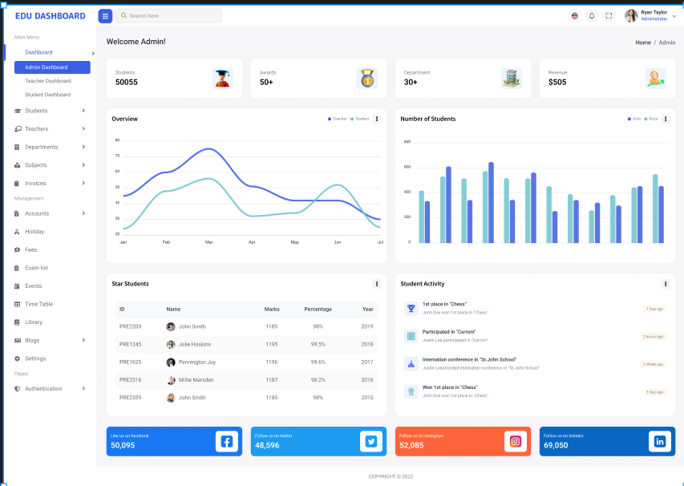
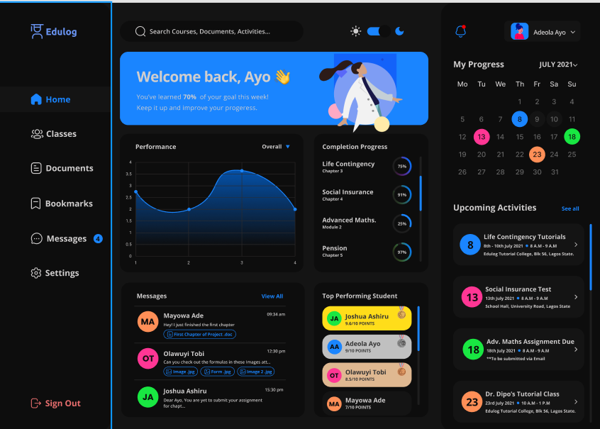
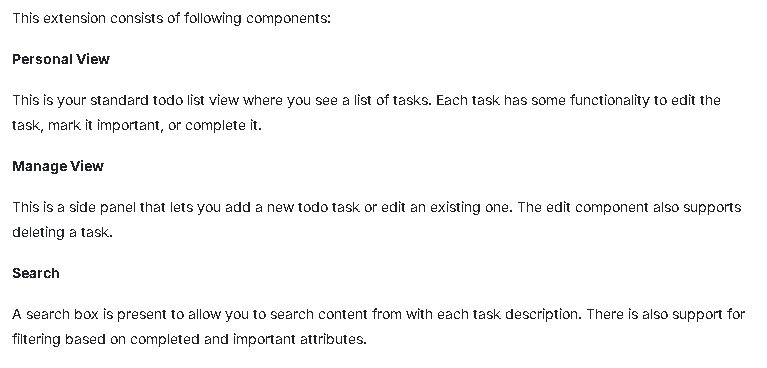
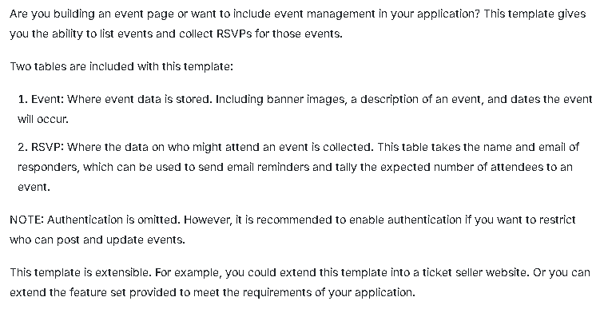

# Referências

## Figma Templates:

Edu Dashbord

Link: https://www.figma.com/design/LefC9qwS9Bct3sVu7d9Mnq/Education-Dashboard--Community-?node-id=0-3&t=6wncdHYuS4mLIoAE-0

Descrição:
Gostei dos temas ,da maneira que os itens estão distribuídos e da aba Atividade que mostra o que o aluno fez recentemente de maneira facilmente organizável

Imagem de Referência:

Edulog Dashboard

Link: https://www.figma.com/design/S5Pcci9kidngsg28vaInt2/Educational-Dashboard--Community-?node-id=2-2513&p=f&t=XOUr92UqkWB0cXkE-0

Descrição: Gostei da tabela Performance, das atividades que precisam ser cumpridas de modo que é fácil de enxergar

Imagem de Referência:

## Xano Templates:

Todo List

Link: https://x8ki-letl-twmt.n7.xano.io/workspace/149677-0/marketplace/item/20

Descrição: Todo-list útil para catalogar as tarefas que o aluno precisaria cumprir

Imagem de Referência:

Event

Link: https://x8ki-letl-twmt.n7.xano.io/workspace/149677-0/marketplace/item/46

Descrição: Eventos que podem ser útil para registrar o banco de dados

Imagem de Referência:
